# Bitácora del taller de Cassandra

- **Nombre:** Sofia Eggenberger
- **Carné:** 20240449
- **Grupo:** G1
- **Tu nodo en el clúster del grupo:** cassandra3

---

## 1. Evidencias

### E1. Tres nodos en tu clúster y tu datacenter

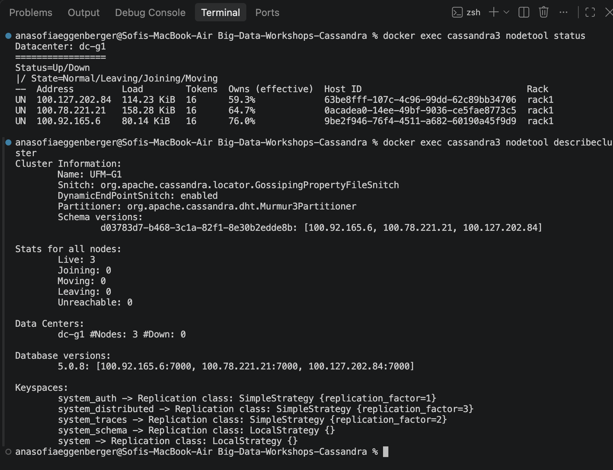

La captura muestra el clúster `UFM-G1`, el datacenter `dc-g1` y los tres nodos en estado `UN`: `100.127.202.84`, `100.78.221.21` y `100.92.165.6`. También muestra `Live: 3` y `dc-g1 #Nodes: 3 #Down: 0`.

### E2. Las copias de la partición de Quetzaltenango

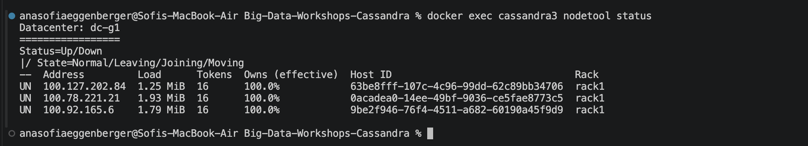

La captura muestra las tres direcciones del clúster en `dc-g1` y las tres en estado `UN`. No muestra `nodetool getendpoints` ni `DESCRIBE KEYSPACE`, así que esta imagen por sí sola no permite verificar la distribución de réplicas ni el RF=3.

### E3. Upsert, TTL e IF NOT EXISTS

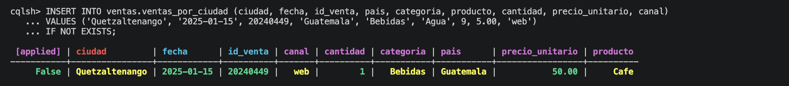

La captura muestra el `INSERT ... IF NOT EXISTS` para Quetzaltenango y `[applied] False` para `id_venta 20240449`, con producto `Cafe` y fecha `2025-01-15`.

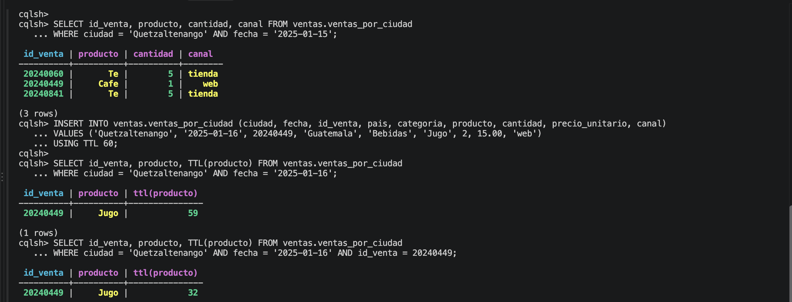

La captura muestra la consulta de tres filas y el TTL de `Jugo` bajando de `59` a `32` segundos. La parte visible no muestra la consulta posterior con `(0 rows)`, así que no puedo afirmar visualmente la expiración completa.

### E4. Un nodo caído: QUORUM frente a ALL

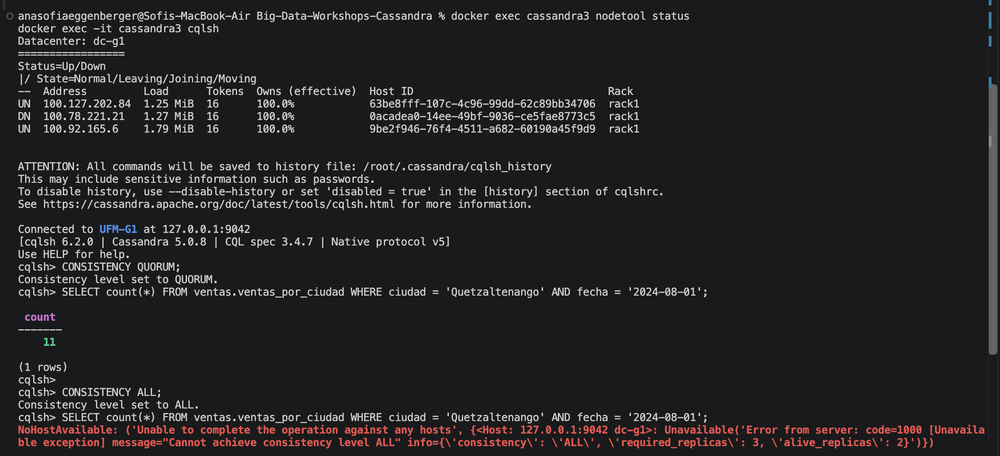

La captura muestra `100.78.221.21` en estado `DN` y los otros dos nodos `UN`. Con `QUORUM` la consulta devuelve `11`, mientras que con `ALL` aparece `required_replicas: 3` y `alive_replicas: 2`.

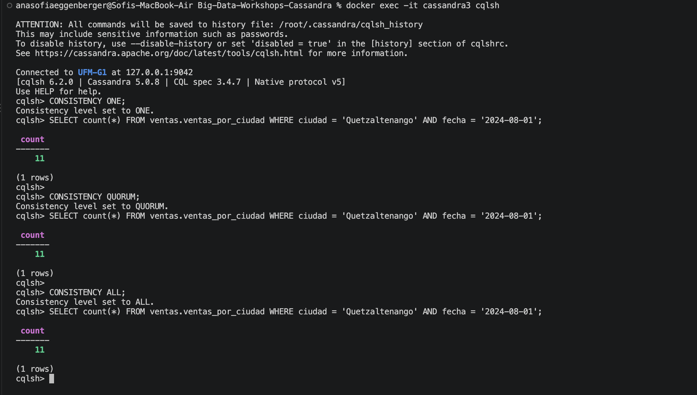

La captura de la ronda sin caídas muestra que `ONE`, `QUORUM` y `ALL` devolvieron `11` para la misma consulta.

### E5. Dos nodos caídos: ONE frente a QUORUM

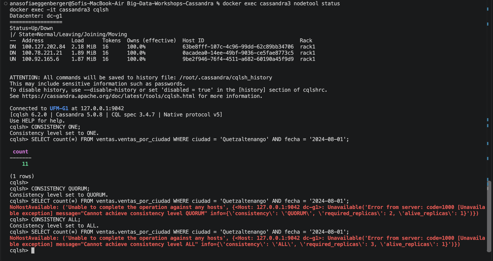

La captura muestra `100.127.202.84` y `100.78.221.21` en `DN`, mientras `100.92.165.6` queda `UN`. `ONE` devuelve `11` y `QUORUM` falla porque requiere `2` réplicas y solo hay `1` viva.

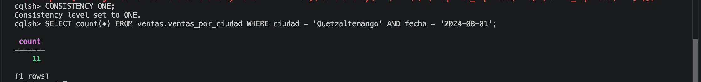

Esta captura adicional vuelve a mostrar `CONSISTENCY ONE` y el resultado `11`.

### E6a. El hint guardado para el nodo caído

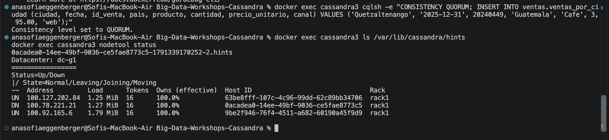

La captura muestra la escritura con `QUORUM`, el archivo de hint `0acadea0-14ee-49bf-9036-ce5fae8773c5-1791339170252-2.hints` y `100.78.221.21` en estado `DN`.

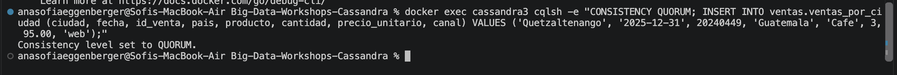

La captura adicional muestra que el `INSERT` con `CONSISTENCY QUORUM` terminó sin error mientras el nodo apagado no estaba disponible.

### E6b. La entrega del hint

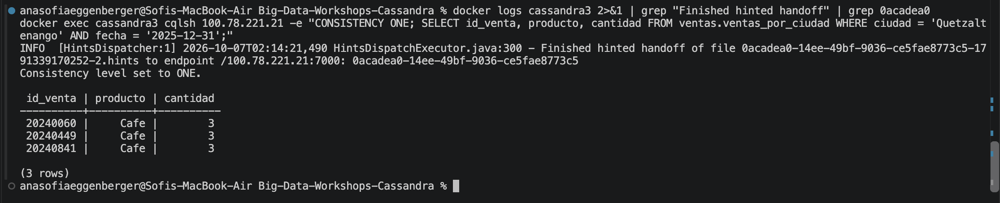

La captura muestra la línea real `Finished hinted handoff` para el Host ID `0acadea0-14ee-49bf-9036-ce5fae8773c5` hacia `/100.78.221.21:7000`. Después, la consulta directa devuelve tres filas, incluida `20240449 | Cafe | 3`.

### Tabla del Paso 8

| Nodos caídos | `ONE` | `QUORUM` | `ALL` |
|---|---|---|---|
| 0 | ✅ | ✅ | ✅ |
| 1 | ✅ | ✅ | ❌ |
| 2 | ✅ | ❌ | ❌ |

---

## 2. Preguntas

**1. ¿Qué línea de la traza muestra que la consulta por ciudad leyó una sola partición, y cuál que la de producto recorrió toda la tabla? ¿Por qué Cassandra rechaza la segunda sin ALLOW FILTERING?**

En mi traza, la línea 16 dice `Executing single-partition query on ventas_por_ciudad` y la línea 21 dice `Read 11 live rows`; la consulta por ciudad leyó una sola partición. La línea 43 de la segunda muestra `Submitting range requests on 17 ranges` y la 45 `Executing seq scan across 1 sstables`, porque recorrió rangos de toda la tabla. Cassandra rechaza esa consulta sin `ALLOW FILTERING` porque `producto` no es partition key ni clustering key y el recorrido puede tener un costo impredecible.

**2. ¿Qué lecturas se comportaron como CP y cuáles como AP? ¿Qué nivel usarías para el saldo de una cuenta y cuál para un contador de reproducciones, y por qué?**

Con nodos caídos, `ONE` se comportó como AP porque respondió con una sola réplica aunque faltaran copias. `QUORUM` y `ALL` conservaron el comportamiento CP: `QUORUM` respondió mientras hubo dos réplicas y rechazó con una, y `ALL` rechazó con una caída. Para el saldo usaría `QUORUM`, porque prioriza una lectura respaldada por mayoría; para reproducciones usaría `ONE`, porque prioriza disponibilidad y acepta convergencia posterior.

**3. ¿Cómo se enteró el nodo apagado de tu venta? ¿Qué pasaría si el nodo estuviera apagado más tiempo que max_hint_window?**

El Host ID de `cassandra1` fue `0acadea0-14ee-49bf-9036-ce5fae8773c5`; el coordinador guardó un hint con ese ID mientras la dirección `100.78.221.21` estaba `DN`. Mi log real dice: `Finished hinted handoff of file 0acadea0-14ee-49bf-9036-ce5fae8773c5-1791339170252-2.hints to endpoint /100.78.221.21:7000: 0acadea0-14ee-49bf-9036-ce5fae8773c5`. Si permanece apagado más que `max_hint_window`, Cassandra deja de conservar hints para ese periodo y haría falta una reparación para reconciliar la copia atrasada.

---

## 3. Mini-reto

### Tablas

| Tabla | Consulta que responde | Partition key | Clustering key |
|---|---|---|---|
| `perfil_por_usuario` | C1 | `usuario_id` | — |
| `reproducciones_por_usuario` | C2 | `usuario_id` | `reproducida_en DESC`, `reproduccion_id ASC` |
| `canciones_por_playlist` | C3 | `playlist_id` | `posicion ASC` |
| `reproducciones_por_cancion_dia` | C4 | `(cancion_id, dia)` | `reproduccion_id ASC` |

### Justificación

**Por qué esas llaves:**

Para C1 uso `usuario_id` como partition key porque el perfil se busca por un usuario exacto y queda en una sola partición. Para C2 también particiono por `usuario_id` y ordeno por `reproducida_en DESC`, con `reproduccion_id` como desempate estable, para devolver las diez reproducciones más recientes sin filtrar. Para C3 uso `playlist_id` y `posicion ASC`, que entrega la playlist completa en el orden solicitado. Para C4 elegí la partition key compuesta `(cancion_id, dia)`, porque la consulta siempre fija una canción y un día y así lee una sola partición antes de contar.

**Qué datos quedaron duplicados entre tablas:**

Como Cassandra no hace JOIN, dupliqué `titulo` y `artista` de `canciones` en `reproducciones_por_usuario` y `canciones_por_playlist`. En C4 materialicé `dia` a partir de `reproducida_en` para formar la partición diaria, y mantuve `reproducida_en` para conservar el evento original. El perfil y los datos de la playlist no se duplicaron porque ninguna otra consulta los necesita.

**Qué hace la aplicación si cambia un dato duplicado:**

La aplicación debe actualizar el dato fuente y después escribir el nuevo valor en cada tabla que lo duplicó. Si cambia el título o el artista de una canción, debe recorrer las reproducciones y playlists afectadas y hacer upsert en ambas tablas. Si solo actualiza una, las consultas pueden devolver valores inconsistentes; por eso la carga repite esos upserts de forma idempotente.

---

## 4. Problemas encontrados

La primera ejecución de `carga.py` encontró una ruta incorrecta hacia `data/`; la corregí y la segunda ejecución cargó las cuatro tablas. Copié las once capturas de la ronda a `capturas/`; la evidencia E2 no incluye `getendpoints` ni `DESCRIBE KEYSPACE`, y E3b no muestra el estado final de TTL expirado. No modifiqué `ventas`, el `compose.yml`, los contenedores ni los otros keyspaces.
